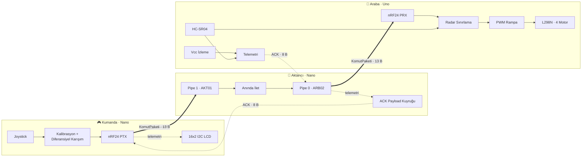
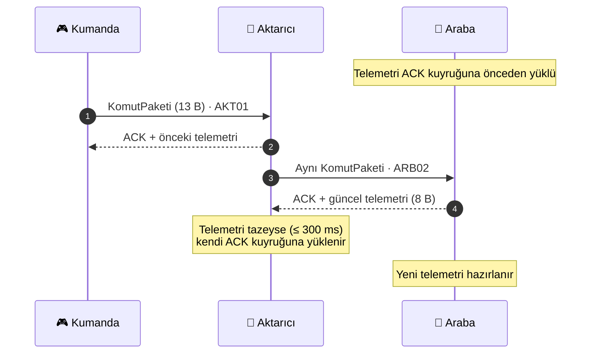
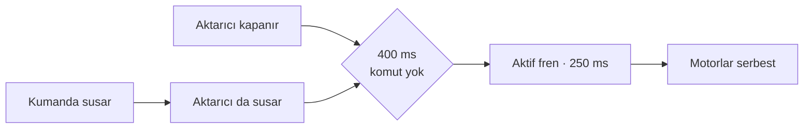

<div align="center">

# 📡 FLAX Aktarıcılı RC Sistem

**nRF24L01+ tabanlı, menzil uzatıcı röleli ve çift yönlü telemetrili uzaktan kumandalı araç sistemi**


`KUMANDA` ──▶ `AKTARICI` ──▶ `ARABA`  ·  50 Hz komut  ·  ACK payload telemetri  ·  400 ms fail-safe

</div>

---

## İçindekiler

- [Genel Bakış](#genel-bakış)
- [Öne Çıkanlar](#öne-çıkanlar)
- [Sistem Mimarisi](#sistem-mimarisi)
- [Haberleşme Protokolü](#haberleşme-protokolü)
- [Donanım](#donanım)
- [Bağlantılar](#bağlantılar)
- [Kurulum](#kurulum)
- [Yapılandırma](#yapılandırma)
- [Güvenlik Mekanizmaları](#güvenlik-mekanizmaları)
- [Seri Port Çıktısı](#seri-port-çıktısı)
- [Sorun Giderme](#sorun-giderme)
- [Proje Yapısı](#proje-yapısı)

---

## Genel Bakış

Bu proje, joystick'li bir kumanda ile dört motorlu bir aracı **araya giren bir aktarıcı (röle) düğümü** üzerinden süren üç parçalı bir telsiz sistemidir. Aktarıcı, kumandanın komutlarını hiç değiştirmeden araca iletir ve aracın telemetrisini (besleme gerilimi, engel mesafesi, durum) aynı yoldan geri taşır. Böylece kumandanın LCD ekranı, araç doğrudan menzil dışında olsa bile canlı veri göstermeye devam eder.

| Düğüm | Kart | Görev |
|:--|:--|:--|
| 🎮 **Verici (Kumanda)** | Arduino Nano + FLAX kumanda kartı | Joystick okuma, kalibrasyon, diferansiyel sürüş karışımı, LCD |
| 📶 **Aktarıcı** | Arduino Nano | Paketleri `AKT01` → `ARB02` arasında köprüleme, telemetri taşıma |
| 🚗 **Alıcı (Araba)** | Arduino Uno + L298N | Motor sürme, radar ile engel önleme, gerilim izleme |

---

## Öne Çıkanlar

- **Menzil uzatma** — Ortadaki aktarıcı, kumanda ile araba arasında şeffaf bir köprü görevi görür.
- **Çift yönlü telemetri** — Telemetri ayrı bir kanal açılmadan, nRF24'ün donanımsal **ACK payload** özelliğiyle geri taşınır.
- **Bloklamayan döngüler** — Aktarıcıda hiç `delay()` yoktur; döngü yalnızca telsizi yoklar ve paketi anında iletir.
- **Joystick kalibrasyonu** — Açılışta 64 örnekle merkez ve ölçek ölçülür, gürültü ve sapma tespit edilip uyarılır.
- **Yumuşak motor kontrolü** — PWM rampası, yön değişiminde ölü zaman ve aktif fren.
- **Radar destekli engel önleme** — HC-SR04 ile histerezisli karar; yalnızca ileri hareket kısıtlanır, geri ve yerinde dönüş her zaman serbesttir.
- **Besleme teşhisi** — ATmega328P'nin dahili 1.1 V bandgap referansıyla Vcc ölçümü; sürüş boyunca görülen en düşük gerilim EEPROM'a kaydedilir.
- **Derleme zamanı güvencesi** — `static_assert` ile paket boyutları üç cihazda da kilitlidir.
- **Ayrıntılı teşhis çıktısı** — Her düğüm açılışta adım adım kendini test eder ve hatalarda çözüm önerisi basar.

---

## Sistem Mimarisi



---

## Haberleşme Protokolü

### Telsiz Parametreleri

| Parametre | Değer |
|:--|:--|
| Kanal | `108` (2.508 GHz, Wi-Fi bantlarının dışında) |
| Veri hızı | `250 KBPS` (en yüksek hassasiyet ve menzil) |
| CRC | 16 bit |
| Payload | Dinamik + ACK payload |
| Kumanda → Aktarıcı adresi | `AKT01` |
| Aktarıcı → Araba adresi | `ARB02` |
| Komut frekansı | 50 Hz (20 ms) |

### Paket Akışı

nRF24 ACK payload'ları **önceden yüklenir**: bir paket geldiğinde donanım, kuyruktaki veriyi otomatik olarak "aldım" cevabının içine koyar. Bu sayede telemetri ek bir iletim gerektirmeden, bir paket gecikmeyle (~20 ms) kumandaya ulaşır.



### Komut Paketi — `KomutPaketi` (13 bayt)

| Ofset | Alan | Tip | Açıklama |
|:-:|:--|:--|:--|
| 0 | `imza` | `uint8_t` | Sabit `0xA5` |
| 1 | `sayac` | `uint8_t` | Döngüsel sayaç (kayıp paket tespiti) |
| 2 | `joyX` | `uint16_t` | Ham ADC, 0–1023 |
| 4 | `joyY` | `uint16_t` | Ham ADC, 0–1023 |
| 6 | `pot` | `uint16_t` | Ham ADC, 0–1023 (kapalıysa 0) |
| 8 | `butonlar` | `uint8_t` | bit0 = Buton 1, bit1 = Buton 2, bit2 = Buton 4 |
| 9 | `sol` | `int16_t` | Sol motor hızı, −255…+255 |
| 11 | `sag` | `int16_t` | Sağ motor hızı, −255…+255 |

> Motor hızları kumandada hesaplanır, çünkü joystick kalibrasyonu yalnızca kumanda tarafında bilinir. Ham değerler de teşhis ve ileride eklenecek özellikler için pakete dahil edilir.

### Telemetri Paketi — `TelemetriPaketi` (8 bayt)

| Ofset | Alan | Tip | Açıklama |
|:-:|:--|:--|:--|
| 0 | `imza` | `uint8_t` | Sabit `0x5A` |
| 1 | `vcc` | `uint16_t` | Anlık besleme gerilimi (mV) |
| 3 | `minVcc` | `uint16_t` | Sürüş boyunca en düşük gerilim (mV) |
| 5 | `mesafe` | `uint16_t` | Radar mesafesi (cm), `999` = engel yok |
| 7 | `durum` | `uint8_t` | bit0 = engel var |

---

## Donanım

<table>
<tr>
<th>🎮 Kumanda</th>
<th>📶 Aktarıcı</th>
<th>🚗 Araba</th>
</tr>
<tr valign="top">
<td>

- Arduino Nano
- FLAX Bluetooth & NRF24 Kumanda Kartı (Nanelab)
- nRF24L01+PA+LNA
- 16x2 I2C LCD
- 18650 pil veya 6–9 V harici besleme

</td>
<td>

- Arduino Nano
- nRF24L01+PA+LNA
- Ayrı 3.3 V regülatör veya nRF24 adaptör kartı
- 10 µF – 100 µF kondansatör

</td>
<td>

- Arduino Uno
- nRF24L01(+)
- L298N motor sürücü
- 4 × DC motor
- HC-SR04 ultrasonik sensör

</td>
</tr>
</table>

---

## Bağlantılar

> [!WARNING]
> nRF24L01 modülleri **yalnızca 3.3 V** ile beslenmelidir; 5 V modülü kalıcı olarak bozar. VCC–GND arasına mutlaka 10 µF (tercihen 100 µF) kondansatör takın. PA+LNA modüller tepe akımda ~115 mA çeker; Arduino'nun dahili 3.3 V çıkışı bunu karşılayamaz.

### nRF24L01 (Aktarıcı ve Araba)

| nRF24 | Arduino |
|:--|:--|
| CE | D9 |
| CSN | D10 |
| MOSI | D11 |
| MISO | D12 |
| SCK | D13 |
| VCC | 3.3 V |
| GND | GND |

> Kumandada modül kartın kendi soketine takılır: **CE = D10, CSN = D9**.

### Araba — L298N ve HC-SR04

| Bileşen | Pin | Arduino |
|:--|:--|:--|
| L298N | ENA (sol PWM) | D5 |
| | IN1 / IN2 | D2 / D3 |
| | ENB (sağ PWM) | D6 |
| | IN3 / IN4 | D4 / D7 |
| HC-SR04 | TRIG | A0 |
| | ECHO | A1 |
| | VCC | 5 V |

> L298N üzerindeki ENA/ENB jumper'ları çıkarılmış olmalıdır. Bir teker ters dönüyorsa `solMotor()` / `sagMotor()` içindeki `HIGH` ve `LOW` yer değiştirilir.

### Kumanda Kartı Pin Haritası

| Bileşen | Pin | Not |
|:--|:--|:--|
| Joystick X / Y | A0 / A1 | Sağ-sol / ileri-geri |
| Joystick butonu | D5 | |
| Potansiyometre | A3 | `POT_KULLAN 1` ile etkin |
| Buton 1 / 2 / 4 | A2 / D6 / D7 | `BUTON_KULLAN 1` ile etkin |
| Buton 3 / 5 | A7 / A6 | Yalnızca analog okunabilir, dahili pull-up yok |
| Buton A / B | D0 / D1 | ⚠️ Donanımsal seri port — kullanılmaz |
| WS2812 RGB LED | D2 | |
| I2C (LCD, MPU6050) | A4 = SDA, A5 = SCL | |

**Besleme:** 18650 pil ile **JP5 takılı**, 6–9 V harici girişle **JP5 çıkarılmış** olmalıdır. Pil ters takılırsa kart kalıcı hasar görür. Kod yüklerken Nano'nun kendi USB bağlantısı kullanılmalıdır.

---

## Kurulum

### 1. Kütüphaneler

Arduino IDE → **Library Manager** üzerinden:

| Kütüphane | Yazar | Kullanan |
|:--|:--|:--|
| `RF24` (≥ 1.4.0) | TMRh20 | Tüm düğümler |
| `LiquidCrystal I2C` | Frank de Brabander | Kumanda |

### 2. Yükleme

| Sketch | Kart |
|:--|:--|
| [`flaxKumandaliVerici`](flaxKumandaliVerici/flaxKumandaliVerici.ino) | Arduino Nano |
| [`flaxAktarici`](flaxAktarici/flaxAktarici.ino) | Arduino Nano |
| [`flaxKumandaliAlici`](flaxKumandaliAlici/flaxKumandaliAlici.ino) | Arduino Uno |

`arduino-cli` ile:

```bash
arduino-cli lib install "RF24" "LiquidCrystal I2C"
arduino-cli compile --fqbn arduino:avr:nano flaxAktarici
arduino-cli upload  --fqbn arduino:avr:nano -p <PORT> flaxAktarici
```

### 3. Çalıştırma

1. Aktarıcıyı ve arabayı açın.
2. Kumandayı açın ve **joystick'e dokunmadan** kalibrasyonun bitmesini bekleyin.
3. LCD'de `BAGLI` yazısını gördüğünüzde sistem hazırdır.

Tüm düğümlerin Serial Monitor hızı **115200 baud**'dur.

### 4. Saha Kullanımı

- Üç cihazda da `RF_GUC` değerini `RF24_PA_MAX` yapın (varsayılan `RF24_PA_MIN` masa testi içindir).
- Aktarıcıyı kumanda ile araba arasına, mümkün olduğunca yükseğe yerleştirin.
- Antenleri dik ve birbirine paralel tutun.
- Masada `PA_MAX` ile test ederken modülleri en az 2–3 metre ayırın; yakın mesafede alıcının ön katı doyar.

---

## Yapılandırma

Aşağıdaki değerler üç cihazda **birebir aynı** olmalıdır: `KANAL`, `VERI_HIZI`, adresler ve paket yapıları.

| Parametre | Dosya | Varsayılan | Açıklama |
|:--|:--|:--|:--|
| `KANAL` | Tümü | `108` | RF kanalı |
| `VERI_HIZI` | Tümü | `RF24_250KBPS` | Klon modüllerde `RF24_1MBPS` kullanın |
| `RF_GUC` | Tümü | `RF24_PA_MIN` | Sahada `RF24_PA_MAX` |
| `DEBUG` | Aktarıcı, Araba | `1` | Periyodik seri port özeti |
| `LCD_KULLAN` | Kumanda | `1` | LCD desteği |
| `LCD_ADRES` | Kumanda | `0x27` | Bazı modüllerde `0x3F` |
| `BUTON_KULLAN` | Kumanda | `0` | Buton 1/2/4 okuma |
| `POT_KULLAN` | Kumanda | `0` | Potansiyometre okuma |
| `PIN_KESIF_MODU` | Kumanda | `0` | Yalnızca pin değerlerini basan test modu |
| `SAFE_ZONE` | Kumanda | `40` | Joystick ölü bölgesi (−255…255 ölçeğinde) |
| `MAX_PWM` | Araba | `255` | Tepe hız sınırı |
| `FREN_AKTIF` | Araba | `1` | Bağlantı kopunca aktif fren |
| `DUR_MESAFE` | Araba | `25 cm` | İleri hareketin engellendiği mesafe |
| `YAVASLA_MESAFE` | Araba | `60 cm` | Hız sınırlamanın başladığı mesafe |

---

## Güvenlik Mekanizmaları

### Fail-safe Zinciri

Aktarıcı kendi başına hiçbir komut üretmez. Zincirdeki herhangi bir halka koparsa araba durur:



### Radar Bölgeleri

| Mesafe | Davranış |
|:--|:--|
| > 60 cm | 🟢 Serbest |
| 25 – 60 cm | 🟡 İleri hız 130 PWM ile sınırlı |
| ≤ 25 cm | 🔴 İleri hareket engellenir |

Engel kararı histerezislidir: **2 ardışık yakın ölçüm** engeli açar, **3 ardışık uzak ölçüm** (+5 cm pay ile) kapatır. Geri gitmek ve yerinde dönmek her zaman serbesttir; aksi halde araç engelden kurtulamaz.

### Motor Koruması

| Mekanizma | Değer |
|:--|:--|
| PWM rampası | 20 ms'de 30 adım (0 → 255 ≈ 170 ms) |
| Yön değişimi ölü zamanı | 70 ms (önce 0'a iner, sonra ters yöne kalkar) |
| Aktif fren süresi | 250 ms |
| Aralık dışı komut | Yok sayılır |
| Açılış durumu | İlk geçerli pakete kadar motorlar kapalı |

---

## Seri Port Çıktısı

<details>
<summary><b>🎮 Kumanda</b></summary>

```text
Joystick 512,498 | Motor sol 150 sag 150 | Aktarici VAR %99 | Araba 4.95V (en dusuk 4.87V) | Engel yok
```

LCD ekranı:

```text
┌────────────────┐
│BAGLI  !M: 18cm │   ← '!' = ileri hareket engellendi
│S:150   G:150   │   ← 2 sn'de bir gerilim ekranıyla değişir
└────────────────┘
```

</details>

<details>
<summary><b>📶 Aktarıcı</b></summary>

```text
Kumanda 50 paket/sn | Arabaya 50 ulasti, 0 ulasmadi | Araba 4.95V | Engel yok
```

</details>

<details>
<summary><b>🚗 Araba</b></summary>

```text
#27 | Baglanti VAR | Motor sol 150 sag 150 | Pil 4.95V (en dusuk 4.87V) | Engel 45 cm YAVAS
Paket 50/sn | Kayip (toplam) 12 | Hatali (toplam) 1
```

`#` numarası sıfıra dönerse Arduino yeniden başlamış demektir (genellikle besleme çökmesi).

</details>

---

## Sorun Giderme

| Belirti | Olası Neden | Çözüm |
|:--|:--|:--|
| `HATA 1: nRF24 modulu hic yanit vermiyor` | Kablo, besleme | Pinleri kontrol edin, 3.3 V + kondansatör |
| `HATA 2: SPI hatti kararsiz` | MISO/MOSI ters, uzun kablo | Bağlantıyı düzeltin, kabloları kısaltın |
| `HATA 3: Ayarlar module yazilamiyor` | Yetersiz besleme | Ayrı 3.3 V regülatör kullanın |
| `nRF24L01 veya KLON` uyarısı | Modül 250 KBPS desteklemiyor | Üç cihazda da `RF24_1MBPS` yapın |
| `AKTARICIDAN HIC ACK GELMIYOR` | Aktarıcı kapalı veya ayarlar uyumsuz | Kanal, hız, adres ve paket yapısını eşleyin |
| LCD boş | Yanlış I2C adresi | `LCD_ADRES` değerini `0x3F` yapın |
| Yakın mesafede bağlantı yok | Alıcı doyması | Modülleri 2–3 m ayırın veya `PA_MIN` kullanın |
| Araba hızlanırken resetleniyor | Brownout | Ayrı regülatör; gerekirse `MAX_PWM` değerini 230'a düşürün |

Araba açılışta önceki sürüşteki en düşük Vcc değerini raporlar. **4600 mV altı** beslemenin motor akım tepelerinde çöktüğünü gösterir.

---

## Proje Yapısı

```text
flaxAktariciliSistem/
├── flaxKumandaliVerici/
│   └── flaxKumandaliVerici.ino   # Kumanda: joystick, karışım, LCD
├── flaxAktarici/
│   └── flaxAktarici.ino          # Aktarıcı: AKT01 → ARB02 köprüsü
├── flaxKumandaliAlici/
│   └── flaxKumandaliAlici.ino    # Araba: motor, radar, telemetri
└── README.md
```
